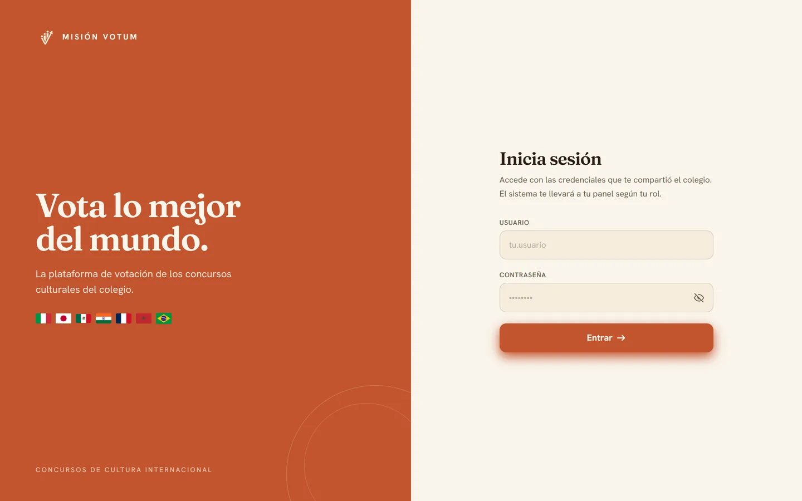
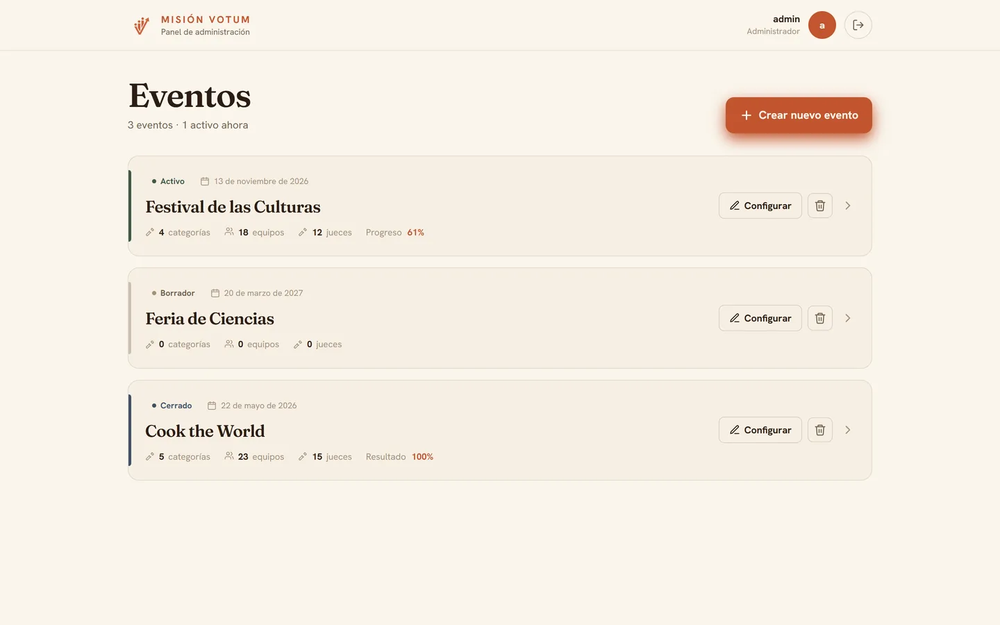
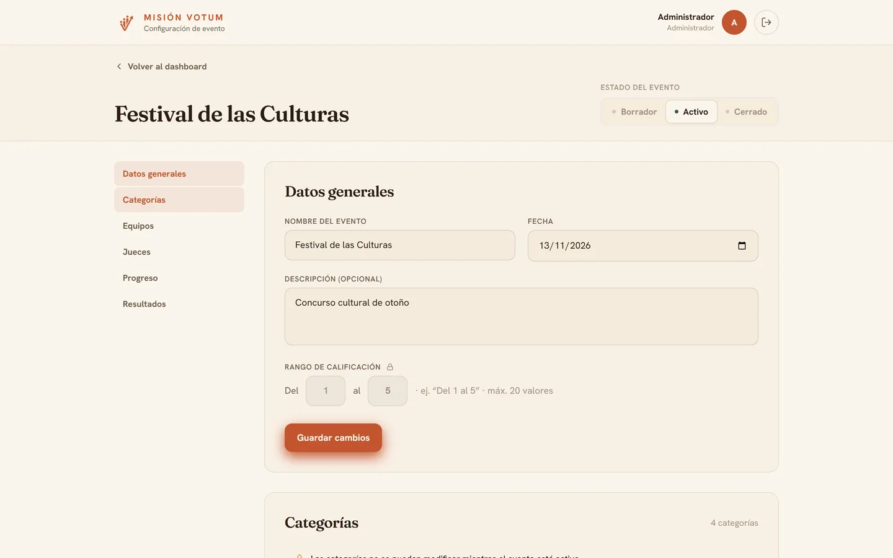
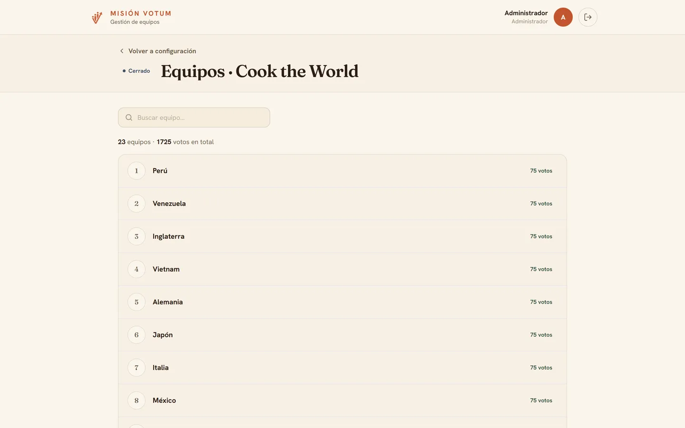
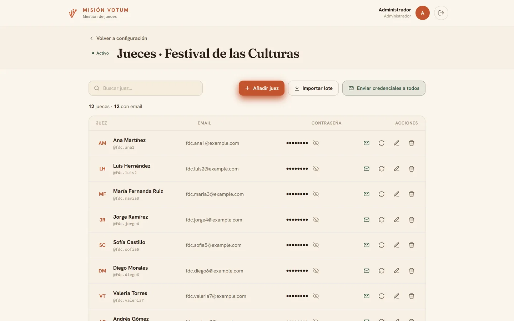
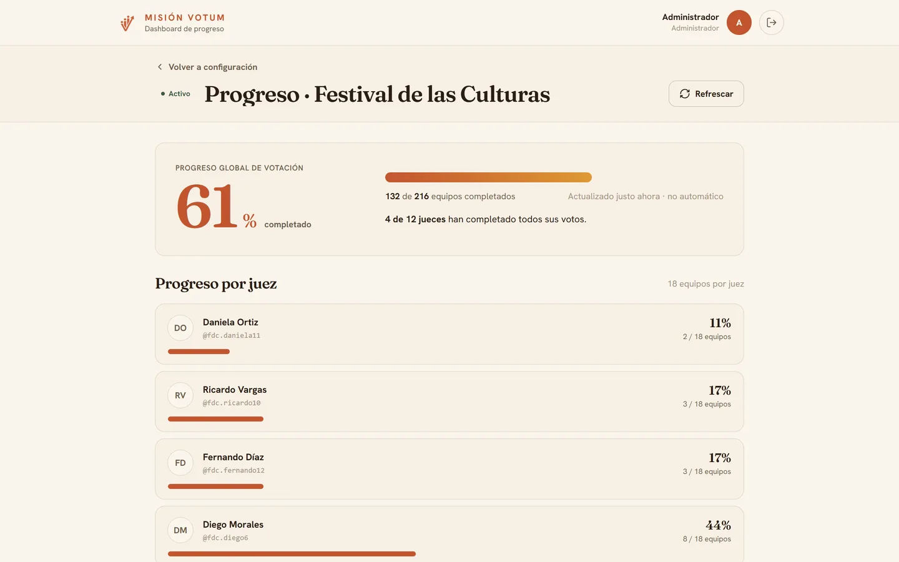
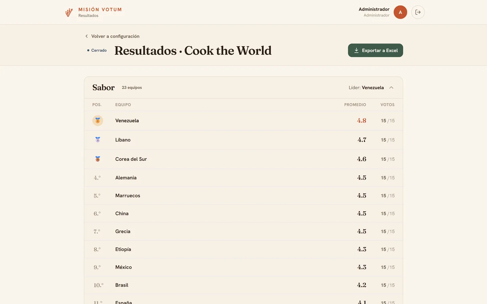
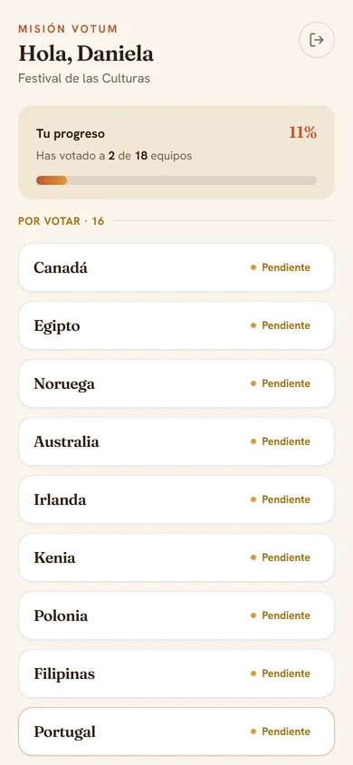
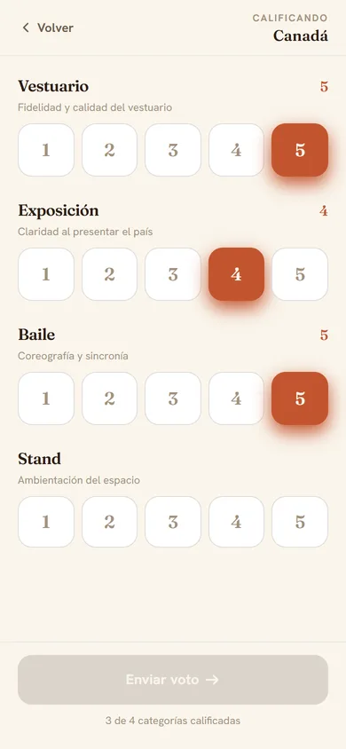

<div align="center">


# Misión Votum

**The voting platform for the cultural contests of Colegio Misión Montessori.**

*Judges score teams from their phones during the contest; the admin watches the progress live, gets rankings per category and exports everything to Excel.*

<a href="https://mision-votum.vercel.app"></a>

[](https://nextjs.org)
[](https://www.typescriptlang.org)
[](https://www.prisma.io)
[](https://neon.tech)
[](https://tailwindcss.com)
[](https://vercel.com)

<br>



</div>

---

## What is Misión Votum?

Twice a year the school holds a cultural contest (food, costumes, dances and stands from countries
around the world). Teams are scored by about fifteen teachers across several categories, and the
results used to be collected on paper. **Misión Votum** replaces that:

- The **admin** sets up the event (score range, categories, teams and judges), sends the judges their
  credentials by email, follows the voting progress and publishes the results.
- Each **judge** logs in from their phone, sees which teams are still pending and scores each category
  with one tap.
- When the event closes, the app computes **averages and rankings per category** and exports a
  **two-sheet Excel file** for the record.

> **Expected scale per event:** ~40 teams, ~15 judges, 5–8 categories (3,000–4,800 votes per event,
> two events per year).

The app is **in production** and protected by login. The interface is in Spanish.

---

## 📸 Screenshots

<sub>Everything except the login comes from a local copy with a fictional demo event; no real
judges, teams or votes are shown.</sub>

### Admin

<div align="center">

&nbsp;


&nbsp;


&nbsp;


</div>

### Judge (mobile)

<div align="center">

&nbsp;
&nbsp;


</div>

---

## ✨ Features

### Events
Each event goes through three states:

| State | What can be done |
| :--- | :--- |
| **Draft** | The admin configures everything. Judges cannot log in. |
| **Active** | Judges vote. Categories and the score range are locked; teams and judges can still be edited. |
| **Closed** | Read only. The admin can export; judges can no longer change their votes. |

Moving an event from Active back to Draft deletes all its votes, and deleting teams or judges that
already have votes asks for a strong confirmation.

### Admin
- 🗓️ **Events dashboard** with state, date, categories, teams, judges and progress at a glance.
- 🎚️ **Custom score range** per event (for example 1–5, up to 20 values) and categories with an
  optional description that judges see while voting.
- 👥 **Teams and judges**: add them one by one or **import a whole list at once**. Usernames and
  passwords for judges are generated automatically.
- 👁️ **Recoverable credentials**: judge passwords are encrypted (not hashed), so the admin can reveal
  them with the eye button, regenerate them, or resend them.
- ✉️ **Credentials by email** to one judge or to all of them, sent sequentially with a short pause to
  respect SMTP limits.
- 📈 **Progress dashboard**: global percentage, teams completed and progress per judge (refreshed by
  hand, so there is no polling during the contest).
- 🏆 **Results** per category with averages, medals for the top three and the number of votes per team.
- 📊 **Excel export** with two sheets:
  - **Summary**: one row per team with the average and position in every category plus the overall
    average.
  - **Detail**: one row per individual vote (audit trail), timestamps in `America/Mexico_City`.

### Judge
- 📱 **Mobile first** and installable as a **PWA** (standalone, no browser bar).
- ✅ Team list with **pending first, voted after**, and a personal progress bar.
- 👆 **One-tap scoring chips** for each category; the vote can only be sent when every category is
  scored, and it can be changed while the event is Active.

### Security
- 🔐 One login screen for both roles; **middleware** protects `/admin` and `/juez` by role.
- 🔑 Admin password hashed with **bcrypt**; judge passwords encrypted with **AES-256-GCM**.
- 🍪 Sessions as a JWT signed with `jose` in an **httpOnly cookie**.
- ⏰ A monthly **Vercel Cron** job keeps the Brevo SMTP key alive (it expires after 90 days without use).

---

## 🛠️ Tech Stack

| Layer | Technology |
| :--- | :--- |
| **Framework** | Next.js 15 (App Router, React 19, Server Components + Server Actions) |
| **Language** | TypeScript |
| **Styling** | Tailwind CSS 3 ("Mercado" palette: terracotta and cream, Fraunces + Hanken Grotesk) |
| **Database** | PostgreSQL on [Neon](https://neon.tech) (scale-to-zero, ~500 ms cold start) |
| **ORM** | Prisma 6 |
| **Auth** | Custom: bcrypt (admin), AES-256-GCM (judges), JWT with `jose` in an httpOnly cookie |
| **Email** | `nodemailer` over any SMTP provider (Brevo in production, Gmail also supported) |
| **Excel** | ExcelJS in a Route Handler |
| **Hosting** | Vercel (Hobby) + Vercel Cron |
| **PWA** | Standalone web manifest |

---

## 🏗️ Project Structure

```
app/
  (auth)/login/            # Login screen (admin and judge share it)
  (auth)/logout/           # Route handler that clears the cookie
  admin/                   # Admin area (desktop, responsive)
    page.tsx               #   Events dashboard
    actions.ts             #   Server actions for events (create, edit, state)
    eventos/[id]/          #   Event configuration + navigation to:
      equipos/             #     · Teams CRUD + bulk import
      jueces/              #     · Judges CRUD + credentials + emails
      progreso/            #     · Progress dashboard
      resultados/          #     · Rankings per category
  api/eventos/[id]/exportar/   # Route handler that builds the .xlsx
  api/cron/keep-smtp-alive/    # Monthly cron for the SMTP key
  juez/                    # Judge area (mobile first)
    page.tsx               #   Team list (pending / voted)
    equipos/[teamId]/      #   Voting screen (score chips)

components/ui/             # Shared components (Modal, ConfirmDialog, StatusBadge, Toast, Skeleton, icons…)
lib/
  auth/                    # crypto (bcrypt + AES), JWT (jose), session helpers
  prisma.ts                # PrismaClient singleton
  events.ts                # State mapping, ordering and progress
  results.ts               # Averages and rankings per category
  excel.ts                 # Workbook (Summary + Detail sheets)
  email.ts                 # SMTP transporter and HTML template

prisma/
  schema.prisma            # Admin, Event, Category, Team, Judge, Vote
  seed.ts                  # Admin seed
  migrations/              # Versioned SQL migrations

middleware.ts              # Protects /admin and /juez by role
public/                    # Logos and PWA manifest
docs/                      # Project spec, design notes and original mockups
```

---

## 🚀 Getting Started

### Prerequisites
- Node.js 20+
- A PostgreSQL database (Neon recommended)
- An SMTP account to send credentials (Brevo works without a custom domain; Gmail needs an App Password)

### 1. Clone and install

```bash
git clone https://github.com/NotJcao17/mision-votum.git
cd mision-votum
npm install
```

### 2. Environment variables

```bash
cp .env.example .env
```

| Variable | Purpose |
| :--- | :--- |
| `DATABASE_URL` | Pooled Postgres connection (Neon → Connection string, with pooler) |
| `DIRECT_URL` | Direct connection for migrations (same string without `-pooler`) |
| `ENCRYPTION_KEY` | AES-256 key, 32 bytes in base64 |
| `JWT_SECRET` | Session cookie signing secret, 32 bytes in base64 |
| `SMTP_HOST`, `SMTP_PORT`, `SMTP_USER`, `SMTP_PASS`, `MAIL_FROM` | SMTP sender (defaults to Gmail `smtp.gmail.com:465` if host and port are omitted) |
| `MAIL_SEND_DELAY_MS` | Optional pause between bulk emails (default 700) |
| `APP_URL` | Optional public URL, adds a login button to the emails |
| `ADMIN_USERNAME`, `ADMIN_PASSWORD` | Admin credentials, used only by the seed |
| `CRON_SECRET` | Secret Vercel sends to the SMTP keep-alive cron |

Generate the keys with:

```bash
node -e "console.log(require('crypto').randomBytes(32).toString('base64'))"
```

### 3. Migrate and seed the admin

```bash
npx prisma migrate deploy   # applies the migrations
npx prisma db seed          # creates or updates the admin from .env
```

> The admin's plain password only lives in your `.env`; the database stores the bcrypt hash. If you
> lose it, run the seed again with a new `ADMIN_PASSWORD`.

### 4. Run

```bash
npm run dev          # http://localhost:3000
```

Log in with the `ADMIN_USERNAME` / `ADMIN_PASSWORD` you set.

---

## 🧭 Typical Flow

**Admin**
1. Create the event: name, date, score range and categories.
2. Add the teams (one by one or bulk import).
3. Add the judges; usernames and passwords are generated.
4. Send the credentials by email (or hand them out; the eye button reveals them).
5. Switch the event to **Active** when the contest starts and follow the progress.
6. **Close** the event at the end, check the results and export the Excel file.

**Judge**
1. Log in with the credentials received.
2. Pick a pending team and score each category with a chip.
3. Send the vote; it can be edited while the event is Active.

---

<div align="center">
  Made for <b>Colegio Misión Montessori</b> · Created by <b>Juan Carlos Orozco Nieto</b>
</div>
